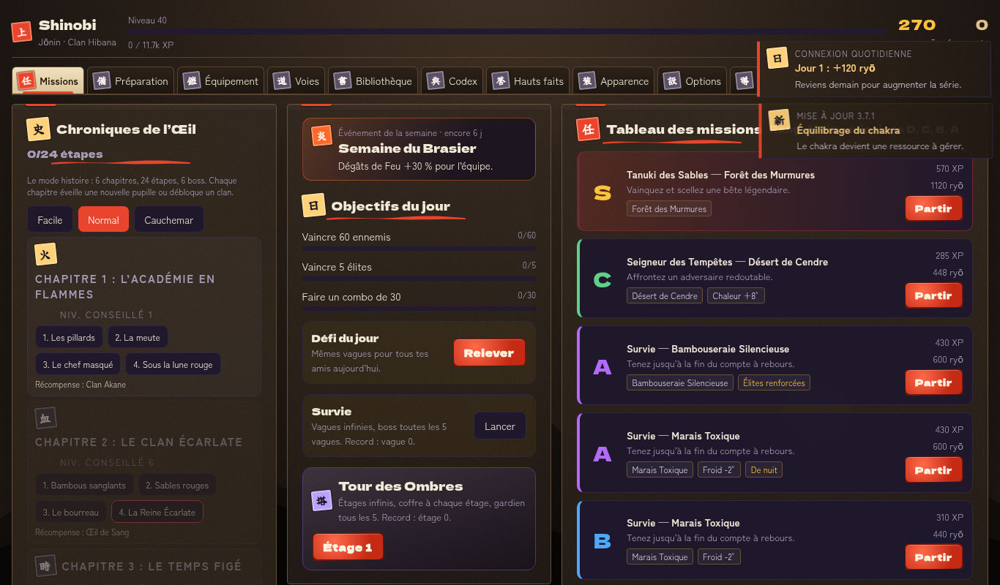
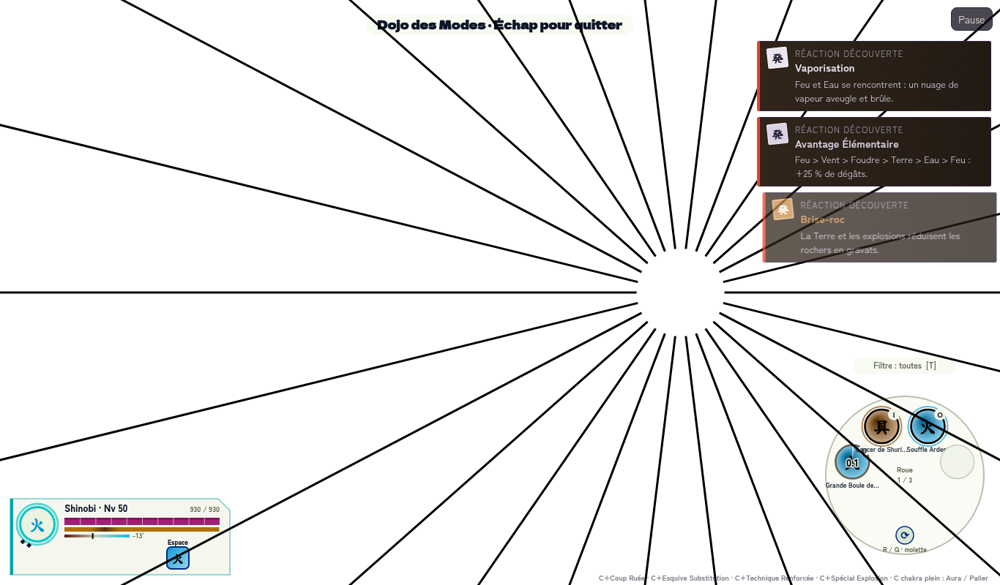
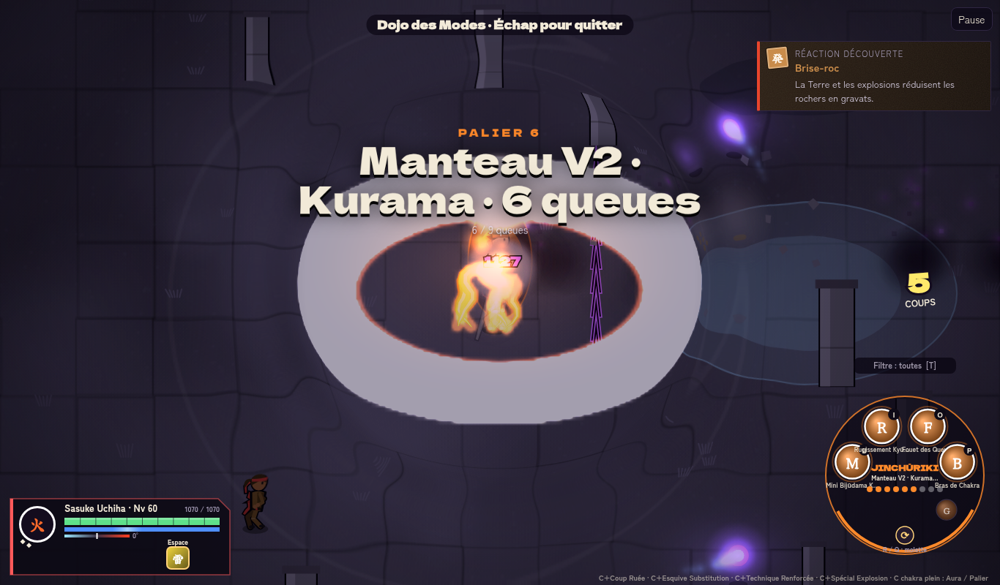
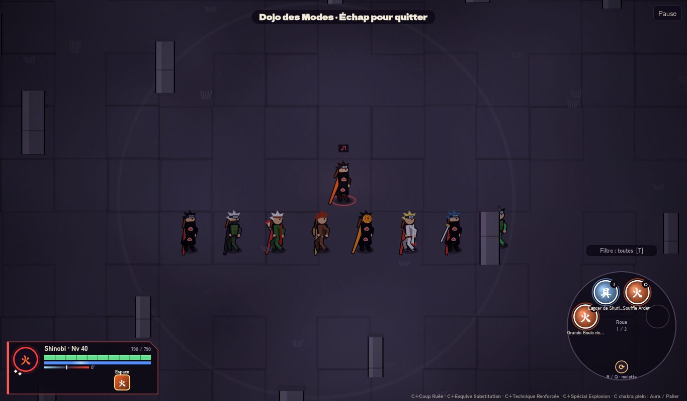

# Shinobi Éternel II

Jeu d'action ninja inspiré de *Naruto*, entièrement dans **un seul fichier `index.html`** (aucune installation, fonctionne hors-ligne). Version actuelle : **v3.8**.

▶️ **Jouer : https://lindcil.github.io/shinobi-eternel/**  
(ou téléchargez `index.html` et ouvrez-le dans un navigateur)

## Contenu
- Mode histoire, missions, survie, Tour des Ombres, dojo, PvP local
- Monde ouvert à 6 zones : maîtres (mode Ermite, 8 Portes, Chidori…), shinobi amicaux/hostiles, créatures à apprivoiser et invoquer, 30 événements (dont 3 rares)
- Combat : combo M1, dash, pas éclair, chocs de projectiles, Bijūdama « nucléaire » et duel de Bijūdama en QTE
- Interface encre & parchemin, 16 accessoires visibles sur le personnage

## Contrôles (clavier / souris)
| Action | Clavier | Manette |
|---|---|---|
| Se déplacer | W A S D (Z Q S D en AZERTY) / flèches | Stick gauche |
| Viser | Souris (sinon auto) | Stick droit |
| Attaque / combo M1 | J ou clic gauche | A |
| Esquive · Substitution | K ou clic droit | B |
| Techniques 1 à 4 | U I O P ou 1-4 | X, Y, LB, RB |
| Technique secrète | Espace | RT |
| Pupille | E | R3 |
| Bête à queues | F | L3 |
| **Charger le chakra (maintenir)** | **C** | LT |
| Apprivoiser / Invoquer (monde ouvert) | G / V | — |
| Pause | Échap | Start |

Manette et écran tactile sont pris en charge (boutons à l'écran). Les touches sont configurables dans **Options**.

## Modes
- **Sharingan** : 8 paliers (1 à 3 tomoe, Mangekyō, 4 stades de Susanoo)
- **Jinchūriki** : autant de paliers que de queues de la bête, avec queues et manteau visibles
- **Éléments** : feu, eau, foudre, vent, terre + avancés (acier, poussière, cristal, bouillonnement, yin-yang…)
- **Ultimes en duo** : techniques combinées avec QTE

## Notes
Voir [PATCH_NOTES.md](PATCH_NOTES.md) et [ROADMAP.md](ROADMAP.md).
